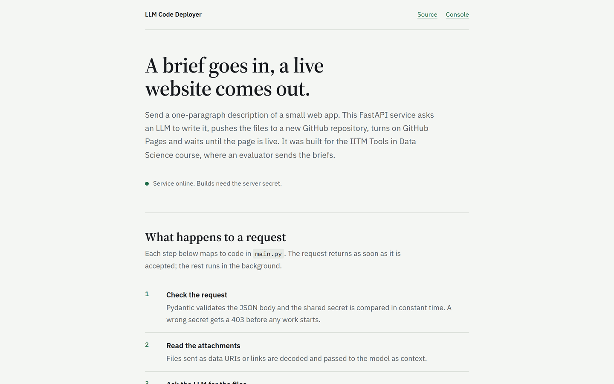

# LLM Code Deployment Agent

A FastAPI service that turns a one-paragraph brief into a static web app with an LLM, pushes it to a GitHub repository, turns on GitHub Pages and checks that the page is live. Built for the IITM Tools in Data Science course, where an evaluator sends the briefs and receives a callback.

| | |
|---|---|
| **Live** | [24f2007692-llm-code-deployer.hf.space](https://24f2007692-llm-code-deployer.hf.space/): how it works and the API. Builds need the server secret. |
| **Stack** | FastAPI, Pydantic, PyGithub and the GitHub REST API, an OpenAI-compatible client (AI Pipe, default model `openai/gpt-4o`) with Gemini as fallback, Docker, Hugging Face Spaces |
| **Built with** | AI coding tools (Claude Code, Google Antigravity) |



## What happens to a request

1. `POST /api/build` validates the body with Pydantic and compares the secret in constant time. A wrong secret gets 403; if the server has no secret configured, every build is refused with 503.
2. The request returns at once with `{"status": "accepted"}`; the build runs as a FastAPI background task.
3. Attachments (data URIs or links) are decoded and passed to the model as context.
4. `call_llm` asks for one JSON object of filename to content: AI Pipe first, then Gemini models, two attempts each.
5. Round 1 creates a public repository; round 2 reads the existing code and asks for a revision.
6. The files are committed with a README and an MIT licence, GitHub Pages is turned on, and the Pages URL is polled until it answers or `DEPLOYMENT_TIMEOUT` (180 s) runs out.
7. The repository URL, commit SHA and Pages URL are posted to `evaluation_url`, retrying up to 4 times (1, 2, 4, 8 s).

## Run it locally

```bash
pip install -r requirements.txt
cp .env.example .env   # then fill in your own values; never commit .env
uvicorn main:app --port 8000
```

Open `http://localhost:8000` for the overview, `/console` for manual builds and `/docs` for the OpenAPI schema.

| Variable | Needed for |
|---|---|
| `MY_SECRET` | Required. Builds are refused until it is set. Use a long random string. |
| `AIPIPE_TOKEN` and/or `GEMINI_API_KEY` | At least one LLM provider |
| `GITHUB_TOKEN`, `GITHUB_USERNAME` | Creating repositories and enabling Pages (token needs `repo` scope) |
| `LLM_MODEL`, `GEMINI_MODEL`, `DEPLOYMENT_TIMEOUT` | Optional overrides |

## API

`POST /api/build`

```json
{
  "email": "you@example.com",
  "secret": "<server secret>",
  "task": "unit-converter",
  "round": 1,
  "nonce": "any-unique-string",
  "brief": "A unit converter for length and weight with a dark mode toggle.",
  "evaluation_url": "https://your-server.example/callback",
  "attachments": [{"name": "logo.png", "url": "data:image/png;base64,..."}],
  "checks": ["document.querySelector('#convert') !== null"]
}
```

Callback sent to `evaluation_url` when the site is live:

```json
{"email": "...", "task": "unit-converter", "round": 1, "nonce": "...",
 "repo_url": "https://github.com/<owner>/unit-converter", "commit_sha": "<sha>",
 "pages_url": "https://<owner>.github.io/unit-converter/"}
```

`GET /api/status` reports whether the LLM providers and GitHub are configured, without revealing keys.

## Limits

- Builds run as in-process background tasks with no job queue, so a restart loses builds in progress.
- One shared secret protects the build endpoint; there are no user accounts or per-user rate limits.
- `checks` are given to the model as requirements; the service does not run them against the generated site.
- No automated tests yet.
- Generated code is published without human review.

## Licence

MIT.
